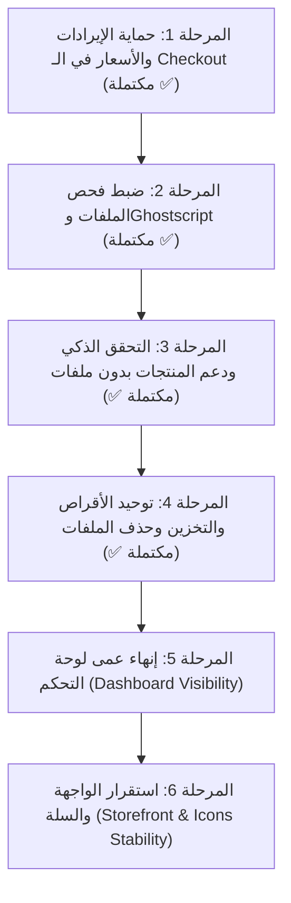

# 🚀 خطة الإصلاح الشاملة لقسم المطبوعات (Print Station Fortress Edition V14.1)
**مشروع Apex Store V2 (Print Express)**

---

## 📌 ملخص تنفيذي للخطة
تهدف هذه الخطة إلى تفكيك وإصلاح **11 ثغرة حيوية** مكتشفة في قسم المطبوعات، تغطي الجوانب الحسابية، مسارات الدفع، أنظمة التخزين، لوحة تحكم الإدارة، واستقرار الواجهة الأمامية. تم ترتيب المهام ترتيباً تصاعدياً حسب الأولوية والخطورة التشغيلية.

---

## 🗺️ المراحل التنفيذية (Phased Implementation Roadmap)



---

## 🔧 تفاصيل المهام الفنية لكل مرحلة

### المرحلة 1: حماية الإيرادات والأسعار في الـ Checkout (أولوية قصوى 🔴 - مكتملة ✅)
**الهدف:** منع خسارة المطبعة لآلاف الجنيهات بسبب إعادة الحساب الخاطئة لكمية = 1 ومساحة = 0 عند الدفع.

- [x] **1.1 تعديل `CheckoutController.php` (تم بنجاح وتم اختباره واعتماده):**
  - قراءة الكمية الفيزيائية الفعلية والأبعاد كـ `(float)` لدعم أنصاف المليمترات (مثل 85.5 مم):
    ```php
    $actualPhysicalQty = max(1, (int)($printingOptions['physical_quantity'] ?? 1));
    $widthMm           = (isset($printingOptions['width_mm']) && is_numeric($printingOptions['width_mm'])) ? (float)$printingOptions['width_mm'] : null;
    $lengthMm          = (isset($printingOptions['length_mm']) && is_numeric($printingOptions['length_mm'])) ? (float)$printingOptions['length_mm'] : null;
    $imageCount        = max(1, (int)($printingOptions['image_count'] ?? 1));
    $bundleQty         = max(1, (int)($cartItem->quantity ?? 1));
    ```
  - إعادة الحساب بالسيرفر عبر `PrintPricingService::calculatePrice` باستخدام القيم الفيزيائية الحقيقية.
  - حساب إجمالي الحزم وجمعه في `$subtotal` بدقة مالية متناهية عبر `bcmul` و `bcadd` لمنع فروقات القروش:
    ```php
    $itemTotal = ($bundleQty === 1) ? $unitBundlePrice : (float)bcmul((string)$unitBundlePrice, (string)$bundleQty, 2);
    $subtotal = (float)bcadd((string)$subtotal, (string)$itemTotal, 2);
    ```
  - تخزين `quantity = $bundleQty` و `price_at_purchase = $unitBundlePrice` و `total = $itemTotal` في `order_items`.
  - الحفاظ على `physical_quantity` بالكامل داخل JSON في `printing_options` لحماية حسابات الشحن والوزن وبوابات الدفع.
  - تأمين قراءة `$typeModel` بـ fallback آمن وتجاوز خصم المخزون عبر `continue;`.
  - **الملف المعدل:** `backend/app/Http/Controllers/Api/Storefront/CheckoutController.php`

---

### المرحلة 2: ضبط فحص الملفات ومحرك Ghostscript (أولوية قصوى 🔴 - مكتملة ✅)
**الهدف:** فك التعليق الدائم لأي طلب طباعة يتطلب ملفاً، ومعالجة غياب أمر `gs` في بيئة ويندوز والإنتاج، واعتماد الملفات الموثوقة فوراً.

- [x] **2.1 إضافة إعدادات Ghostscript المعيارية في `config/services.php` و `.env`:**
  - تسجيل مصفوفة `'ghostscript'` في `config/services.php`:
    ```php
    'ghostscript' => [
        'enabled' => env('GHOSTSCRIPT_ENABLED', false),
        'path' => env('GHOSTSCRIPT_PATH', null),
    ],
    ```
  - إضافة المتغيرات الافتراضية في `.env` و `.env.example` لمنع توقف السيرفر عند عمل `config:cache`:
    ```env
    GHOSTSCRIPT_ENABLED=false
    GHOSTSCRIPT_PATH=
    ```
- [x] **2.2 اعتماد الملف الفوري في `PrintStationController.php`:**
  - بعد نجاح الفحص الأمني اللحظي (MIME Type + Magic Bytes + Zip Bomb Guard + PDF Parser):
    يتم وسم الملف كـ `file_status = 'approved'` مباشرة لعدم حظر الـ Checkout.
  - عدم استدعاء (dispatch) لـ `ValidatePrintFileJob` نهائياً طالما أن `config('services.ghostscript.enabled') === false`.
- [x] **2.3 تصريح القرص والمسار في `ValidatePrintFileJob.php`:**
  - استبدال `Storage::disk('s3')` بقرص التخزين المحلي الفعلي `Storage::disk('local')`.
  - جلب المسار المطلق للملف عبر `Storage::disk('local')->path(...)` ومسار المنفذ من `config('services.ghostscript.path')`.
  - فحص `config('services.ghostscript.enabled')` وتجاوز الفحص باعتماد الملف في حال التعطيل.
  - **الملفات المعدلة:**
    - `backend/config/services.php`
    - `backend/.env` & `backend/.env.example`
    - `backend/app/Http/Controllers/Api/Storefront/PrintStationController.php`
    - `backend/app/Jobs/ValidatePrintFileJob.php`

---

### المرحلة 3: التحقق الذكي ودعم المنتجات بدون ملفات (Validation & Flow Fix 🟡 - مكتملة ✅)
**الهدف:** السماح بإضافة منتجات طباعة لا تتطلب رفع ملفات (أو بملفات اختيارية) دون رمي خطأ تحقق 422، وحماية السيرفر من رمي 404 بدلاً من 422.

- [x] **3.1 التحقق الشرطي وحماية معرف نوع الطباعة في `PrintStationController.php`:**
  - استخراج نوع الطباعة مسبقاً عبر `PrintingType::find($request->printing_type_id)` بدون `findOrFail` لتجنب خطأ 404 قبل التحقق.
  - جعل التحقق شرطياً وفق طبيعة المنتج:
    ```php
    'temp_file_ids' => ($printingType && $printingType->requires_upload) ? 'required|array|min:1' : 'nullable|array',
    'temp_file_ids.*' => 'required|string|uuid|exists:temporary_uploads,id',
    ```
- [x] **3.2 حماية حلقة نقل الملفات من الانهيار (Loop Guard):**
  - وضع حماية `if (!empty($tempFileIds))` لتجاوز حلقة نقل الملفات بسلاسة إذا لم يتم رفع ملفات أو إذا كان المنتج لا يتطلب ذلك.
  - **الملف المعدل:** `backend/app/Http/Controllers/Api/Storefront/PrintStationController.php`

---

### المرحلة 4: توحيد منظومة التخزين والأقراص وحذف الملفات (Storage & Cleanup Harmonization 🟡 - مكتملة ✅)
**الهدف:** توحيد مسار الأقراص على `local`، حذف أجزاء الـ Chunks فور التجميع، إغلاق ثغرات IDOR وPath Traversal، وحماية ملفات الطلبات من الحذف نهائياً.

- [x] **4.1 توحيد القرص وتجميع الـ Chunks في `ChunkUploadController.php`:**
  - تجميع الملفات على `Storage::disk('local')` في المسار المتوافق `temp_uploads/{uuid}.{ext}`.
  - حذف مجلد أجزاء الـ Chunks (`chunks/{identifier}`) فور اكتمال التجميع لمنع امتلاء مساحة السيرفر.
  - قراءة عدد الصفحات تلقائياً لملفات الـ PDF الكبيرة عبر `PdfParser`.
  - تخزين السجل في `temporary_uploads` بـ UUID ومطابقة استجابة الـ JSON مع استجابة `tempUpload`.
- [x] **4.2 إعادة هندسة أمر تنظيف الملفات `CleanOldPrintFiles.php` مع حماية 100% للطلبات:**
  - قراءة `uploaded_files` كقاموس فئات أو مصفوفة كائنات مع فحص `is_string($path) && !empty($path)`.
  - **بوابة الحماية الصارمة `isFileProtected`:**
    - فحص عدم وجود المسار في جدول `order_items` نهائياً (ملفات الطلبات مصانة ولا تُمس إطلاقاً).
    - فحص عدم وجود المسار في `order_item_addons`.
    - فحص عدم وجود المسار في أي سلة نشطة أو معلقة خلال آخر 14 يوماً.
  - تنظيف أجزاء الـ Chunks المهجورة التي مر عليها أكثر من 24 ساعة.
  - تنظيف الـ Temporary Uploads المهجورة التي مر عليها أكثر من 24 ساعة.
  - تنظيف عناصر السلات المهجورة التي تجاوزت 14 يوماً ولم تتحول لطلب مع وسمها بـ `deleted_by_system`.
- [x] **4.3 تحصين دالة `deleteUnlinkedFile` في `PrintStationController.php` وتحديث الواجهة:**
  - فحص الصلاحية (Anti-IDOR): التحقق الصارم من ملكية السلة عبر `X-Session-ID` أو `customer_id`.
  - الحماية من Path Traversal: استخراج مسار الملف حصرياً من سجل قاعدة البيانات الموثق وليس من مدخلات العميل.
  - الحذف الفعلي من `Storage::disk('local')`، وإزالة الفئة من قاموس `uploaded_files` في قاعدة البيانات.
  - إضافة Axios Request Interceptor في `storefront/services/api/printingApi.ts` لتمرير ترويسة `X-Session-ID` تلقائياً مع كل طلب.
  - **الملفات المعدلة:**
    - `backend/app/Http/Controllers/Api/Storefront/ChunkUploadController.php`
    - `backend/app/Console/Commands/CleanOldPrintFiles.php`
    - `backend/app/Http/Controllers/Api/Storefront/PrintStationController.php`
    - `storefront/services/api/printingApi.ts`

---

### المرحلة 5: إنهاء عمى لوحة التحكم الإدارية (Dashboard Operations & Order View ✅ - تم التنفيذ والتحقق)
**الهدف:** تمكين إدارة المطبعة من رؤية كافة مواصفات طلب الطباعة وتحميل ملفات العملاء بنقرة زر.

- [x] **5.1 تحديث شاشة تفاصيل الطلب `OrderDetailsModal.tsx`:**
  - فحص إذا كان العنصر `item_type === 'printing'`.
  - عرض جدول مرتب يحتوي على:
    - الأبعاد والمقاسات (العرض × الطول).
    - الخيارات المحددة (نوع الورق، التجليد، السلوفان، البصمة، عدد الصفحات).
    - ملاحظات العميل الخاصة.
  - إنشاء أزرار لتحميل ملفات التصاميم لكل فئة (الغلاف، الصفحات الداخلية، ماسك الـ UV).
- [x] **5.2 إنشاء Endpoint آمن لتحميل ملفات الطباعة للإدارة:**
  - مسار في الباك إند: `GET /api/v1/admin/orders/items/{itemId}/files/{category}/download` محمي بـ `auth:sanctum` مع حماية صارمة من ثغرات Path Traversal والتحقق من القرص المحلي `local`.
- [x] **5.3 إكمال نواقص شاشات إعدادات الطباعة:**
  - إضافة حقول `thickness_factor`, `upload_categories`, `bleed_margin`, `safe_zone` في `dashboard/app/printing/product-types/edit/types/edit/_components/PrintingTypeForm.tsx`.
  - إضافة حقل اختيار `required_upload_category` في `dashboard/app/printing/product-types/edit/types/edit/_components/AttributesBuilder.tsx`.
  - تحديث التحقق في `PrintingTypeController` لدعم القيم العشرية في `thickness_factor`.
  - **الملفات المعدلة:**
    - `dashboard/app/orders/components/OrderDetailsModal.tsx`
    - `dashboard/app/orders/types/order.types.ts`
    - `backend/app/Http/Controllers/Api/OrderController.php`
    - `backend/app/Http/Controllers/PrintingTypeController.php`
    - `backend/routes/api.php`
    - `dashboard/app/printing/product-types/edit/types/edit/_components/PrintingTypeForm.tsx`
    - `dashboard/app/printing/product-types/edit/types/edit/_components/AttributesBuilder.tsx`

---

### المرحلة 6: استقرار واجهة المتجر وتجربة العميل (Storefront & Icons Stability ✅ - تم التنفيذ والتحقق)
**الهدف:** منع ظهور خطأ `ChunkLoadError: icons_briefcase_js` نهائياً، والحفاظ على سلة العميل عند تسجيل الدخول.

- [x] **6.1 التخلص من الـ Dynamic Chunk Imports في الأيقونات:**
  - في `storefront/app/print-station/page.tsx`:
    استبدال `dynamic(dynamicIconImports[...])` بخريطة أيقونات استاتيكية سريعة ومباشرة (`STATIC_ICON_MAP`) مع نوع `LucideIcon` الصارم تحتوي على كافة الأيقونات المعتمدة للأقسام، مما يقضي جذرياً على خطأ تجزئة الـ Chunks.
- [x] **6.2 إضافة Redirect في `next.config.mjs` ومسار التوجيه:**
  - تحويل أي طلب للرابط ذي المسافة `/print station/` أو `/print%20station/` تلقائياً وبشكل دائم إلى `/print-station/` في كل من `next.config.mjs` ومسار `storefront/app/print station/page.tsx`.
- [x] **6.3 تأمين سلة الطباعة عند تسجيل الدخول في `AppContext.tsx` و `AuthController.php`:**
  - تعديل منطق مزامنة السلة `initCart` لترحيل وحفظ عناصر الطباعة بدلاً من تجاهلها.
  - ربط سلة الجلسة الحالية بحساب العميل عند تسجيل الدخول أو إنشاء الحساب في `AuthController.php`.
  - استدعاء `refreshCart()` فور تسجيل الدخول في `auth/page.tsx` و `callback/page.tsx`.
  - **الملفات المعدلة:**
    - `storefront/app/print-station/page.tsx`
    - `storefront/next.config.mjs`
    - `storefront/app/print station/page.tsx`
    - `storefront/context/AppContext.tsx`
    - `storefront/app/auth/page.tsx`
    - `storefront/app/auth/callback/page.tsx`
    - `backend/app/Http/Controllers/Storefront/AuthController.php`

---

## 🧪 خطة الاختبار والتحقق (Verification & Quality Gates)

1. **اختبار الدفع والأسعار (Financial Testing - تم التحقق ✅):**
   - مطابقة سعر السلة وسعر الدفع بالسيرفر بالمليم عبر `bcmul` و `bcadd`.
   - سلامة حفظ الكمية في جدول الطلبات كحزم مع تخزين الكمية الفيزيائية والأبعاد.
2. **اختبار فحص واعتماد الملفات (تم التحقق ✅):**
   - اعتماد الملفات السليمة `approved` فوراً دون تعليق الـ Checkout.
   - تعطيل تشغيل Ghostscript افتراضياً مع فحص المسار الصحيح.
3. **اختبار التحقق من المدخلات (تم التحقق ✅):**
   - إرسال معرف غير صالح يعود بـ 422 ValidationException نظيفة وليس 404.
   - فحص عناصر `temp_file_ids.*` لمنع تمرير قيم فارغة أو غير صالحة.
4. **اختبار التخزين والتنظيف والأمان (تم التحقق ✅):**
   - اختبار رفع وتجميع الـ Chunks بنجاح وحذف مجلد الأجزاء فور التجميع.
   - اختبار فحص ثغرة IDOR في `deleteUnlinkedFile` وحظر المهاجم بـ 403.
   - تشغيل أمر التنظيف `print:clean-old-files --dry-run` والتأكد من حماية ملفات الطلبات 100%.
